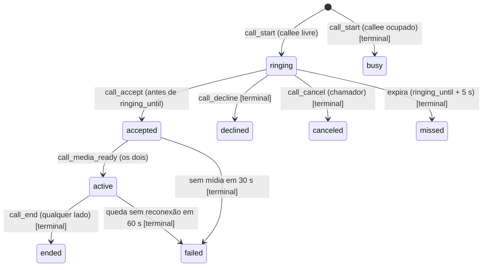
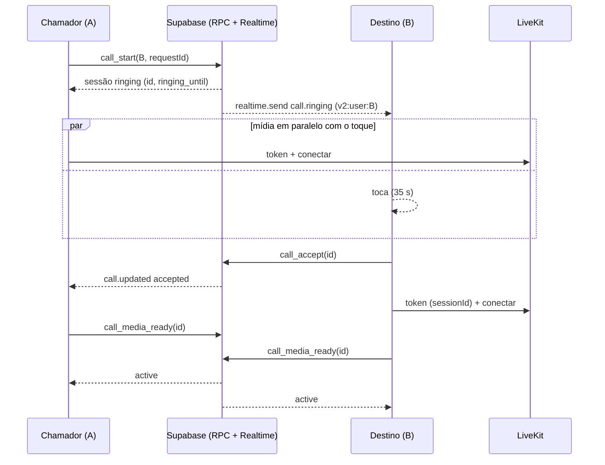

# PLAN: sistema de comunicação (presença, chamadas 1:1, base para mensagens e salas)

Data: 2026-10-12. Status: **proposta, aguardando aprovação do dono. Nenhum código foi escrito.**
Base: `RESUMO.md` e `REVALIDACAO.md` (leia primeiro). Rótulos: `[VERIFICADO: arquivo:linha]` ou `[INFERIDO]`. Tudo que depende do schema real ou do código da API do Render está `[INFERIDO]`.
Skills usadas para este plano: `architecture-designer`, `the-fool` (seção "Desafio"), mais as 6 da revalidação (lista em `REVALIDACAO.md`).

## 0. Resumo executivo

1. O risco crítico (canais Realtime públicos) **não tem contenção que dispense app novo**. Qualquer correção, inclusive filtrar remetente no receptor, é código do cliente. Dá para fazer uma versão **compatível** (1.0.3) que
   não derruba quem está no app antigo, mas a adoção é manual (o app não se atualiza sozinho, ver §3.3), então o risco só fecha de verdade quando o acesso público do Realtime for desligado, o que **derruba todos os clientes antigos** (documentação oficial).
2. A correção definitiva é um **protocolo v2**: canais `private: true` com policies, eventos de chamada e presença **publicados pelo servidor** (`realtime.send` a partir de funções SQL), identidade vinda do JWT. Convive com o v1 durante uma janela, com critério mensurável para desligar o antigo.
3. A causa da presença offline **não está provada** e a hipótese que eu defendia (timers estrangulados) foi rebaixada. O plano **mede antes de construir** (P-1 a P-3) e começa pelas mitigações baratas (heartbeat do Realtime em Worker, `leave` com carência, chave por instância) antes de qualquer heartbeat nativo.
4. Ordem recomendada (difere da sugerida em um ponto; ver §2): **1.0.3 compatível** = A1 + B1 + D1 + F1, depois **C** (detecção ambiente, sem dependência de schema), e só então o bloco bloqueado pela Fatia 0 (A2, B2/B3, D2, E).
5. Esforço total honesto: **9 a 14 semanas de um desenvolvedor** (§11), com ±50% de incerteza até a Fatia 0 chegar.

## 1. Estratégia de testes manuais: quais dos P-1..P-14 são imprescindíveis

| ID | Decide o quê | Veredito |
| --- | --- | --- |
| **P-1, P-2, P-3** | Se o heartbeat nativo (B4) entra no plano e qual mitigação vale (H1, H2, H7, H8, H3) | **IMPRESCINDÍVEIS** (você pediu): rodar com **uma** instância por conta |
| **P-10** | Se F1 (excluir só o WebView2) entra na 1.0.3 | **IMPRESCINDÍVEL**, 10 minutos |
| **P-14** (consultas do schema) e o repo da API | Desbloqueiam a Fatia 0 | **IMPRESCINDÍVEL para o bloco bloqueado**, não para a 1.0.3 |
| P-4 | Confirma o Problema 2 | recomendado (15 min); o código já prova a causa, o teste só protege contra surpresa |
| P-5, P-7, P-8, P-11 | Aceite de D1/D2 | podem esperar; viram **testes de aceite** |
| P-6 (cold start), P-9 (DM offline) | Aceite de D1 e E | podem esperar |
| P-12 | Backlog de drivers | pode esperar |
| P-13 | Só confirmaria o que a documentação oficial já afirma | **opcional, só em contas de teste**; não bloqueia nada |

## 2. Ordem das fatias, com justificativa

Sua ordem: (a) conter o Realtime, (b) presença, (c) detecção ambiente, (d) chamadas 1:1, (e) DMs, (f) áudio da tela inteira, (g) drivers.

**Concordo com o princípio e discordo em três pontos:**
- **(a) vira duas fatias.** A1 (contenção compatível, sem servidor) vai já; A2 (canais privados) **precisa da Fatia 0** e não pode ser planejada com precisão antes.
- **Antecipar os itens pequenos de (d) e (f) para a 1.0.3.** O reconhecimento de "autenticacao", o guard do transceiver e o convite em paralelo com a mídia são correções de 1 a 3 dias, sem schema, que resolvem sintomas que o usuário já viu. Esperar a máquina de estados do servidor (D2, grande) para só então corrigi-los deixa os bugs vivos por meses. F1 (Rust, ~2 dias) também não depende de schema.
- **(c) vem antes do bloco bloqueado**, porque é independente de schema/API e resolve um problema observado (jogo fora do hub).

Resultado:

| Release | Fatias | Depende de Fatia 0? |
| --- | --- | --- |
| **Fatia 0** (paralela, é trabalho seu) | insumos | n/a |
| **1.0.3 "estabilização compatível"** | A1, B1, D1, F1 (F1 só se P-10 confirmar) | **não** |
| **1.1.0** | C (detecção ambiente) | não |
| **1.2.0 "protocolo v2"** | A2, B2/B3, D2, depois E | **sim (bloqueadas)** |
| backlog | B4 (heartbeat nativo, só se P-1 pedir), G (drivers), F2 (consolidar `audio_capture`) | G: audit only |

## 3. Compatibilidade com versões antigas (seu item 3)

### 3.1. O que a documentação oficial confirma
- Desligar "Allow public access" faz clientes que não usam `config.private = true` serem recusados com `PrivateOnly`, e **qualquer mudança nessa tela desconecta todos os clientes** (Supabase, Realtime Settings).
  Logo: **exigir canais privados derruba o app antigo** (presença, fast-path de DM, convites de chamada e sinalização usam canais públicos).
- Enquanto a opção ficar ligada, canais privados **funcionam em paralelo** com os públicos (a policy só é checada nos privados). É isso que permite o expand/contract.

### 3.2. Metadados de versão (para saber quem está na rede)
- `APP_PROTOCOL_VERSION` (inteiro; v1 = 1, o novo = 2) e `appVersion` (`getVersion()`), enviados em: o heartbeat de presença (coluna nova), o `metadata` do participante LiveKit (hoje só `{avatar}`: `useVoiceCall.ts:1969`) e o payload de convite do caminho legado.
  Cliente que não envia = **protocolo 1**.
- Uma tabela de configuração `app_config` (`min_protocol_version`, flags remotas) lida no boot e a cada 10 min pelo cliente novo. Serve de **kill switch** sem lançar versão (só vale para clientes que já têm a leitura).

### 3.3. Limite duro: o app não se atualiza sozinho
`checkForUpdates` consulta a última release do GitHub e `downloadUpdate` abre o navegador (`src/lib/tauriAPI.ts:439-446`); `tauri.conf.json` tem `updater.pubkey = ""` e `endpoints = []` [VERIFICADO: `tauri.conf.json:60-65`].
**Consequência:** a adoção depende de cada amigo baixar o instalador. A janela de convivência precisa ser longa, e o banner "versão obsoleta" entra já na 1.0.3 (para a próxima virada, não para esta).
Decisão a considerar (sua): configurar o updater do Tauri com assinatura (ADR futura); sem isso, o critério de desligamento é o que mede a rede, não uma data.

### 3.4. Janela de convivência (expand/contract)
1. **Expand (1.0.3, 1.1):** nada muda na rede; só metadados e correções compatíveis.
2. **Dual-stack (1.2.0):** cliente novo **assina os dois conjuntos de tópicos** (v1 públicos e v2 privados) e **publica nos dois enquanto houver par v1**. Escolha por par: se o `protocol_version` do par for 2, publica só no v2 e **ignora controle vindo do tópico v1 para aquela sessão**; se for 1 ou desconhecido, usa v1. Dedupe por `event_id`/`call_session_id`.
3. **Contract:** desligar o v1 quando **todas** forem verdade: (i) ≥ 95% dos usuários com heartbeat nos últimos 7 dias têm `protocol_version = 2`; (ii) pelo menos 6 semanas desde o lançamento da 1.2.0; (iii) aviso in-app e nas notas da release com ≥ 14 dias de antecedência; (iv) ensaio no projeto de **staging** do desligamento de "Allow public access" com os clientes novos funcionando.
   O desligamento é uma ação única no painel, em horário de baixo uso, e **desconecta todos** (os novos reconectam sozinhos). **Rollback:** religar a opção (também desconecta uma vez).
4. Sem `protocol_version` observável, o critério (i) não existe: por isso o heartbeat com versão sai **antes** (1.0.3/B1) do dual-stack.

### 3.5. Contenção de curto prazo "sem app novo": avaliação e recomendação
**Não existe contenção do lado do servidor que impeça forja nos canais públicos sem derrubar o app antigo** (a única alavanca é desligar o acesso público; baixar "max events per second" só limita volume, não a forja).
Qualquer filtro no receptor é código do cliente, então "sem app novo" é impossível; o que dá para ter é **um app novo que não quebra o antigo** (1.0.3). Conteúdo recomendado (Fatia A1):
1. **Validar o par esperado no receptor** para `call:end`, `call:kick`, `call:privacy`, `call:answer` e `call:signal`: só aceitar de quem é o par da sessão atual (1:1: `friendUid`; sala: `hostUid` do servidor/sessão). Remove o `|| !currentHost`. **Limite honesto:** o `senderId` ainda vem do payload, então quem conhece os UIDs forja; o filtro bloqueia abuso casual e aleatório, não um atacante que sabe os dois UIDs. É melhora real, não solução.
2. **Convite só de amigo:** descartar `call:invite` de quem não está na lista de amigos.
3. **Fast-path de DM sem texto** quando o par for protocolo ≥ 2: publica só `{ id, chatId, clientId }` e o destinatário lê a linha (protegida por RLS). Isso **fecha o vazamento de confidencialidade** para pares atualizados. Para par v1/desconhecido continua o payload completo (senão o app antigo mostra mensagem vazia).
4. **Parar de publicar** no canal global `checkpoint_presence_bus` (`track`) quando o cliente novo tiver audiência de amigos; mantém a escuta por compatibilidade.
5. **Banner de versão** quando o `app_config.min_protocol_version` for maior que a do cliente.
**Recomendação:** fazer A1 já (3 a 4 dias) e tratá-la como **mitigação**, não como correção. O risco só fecha com A2 + desligamento do acesso público.

## 4. Fatia 0: insumos (BLOQUEIO das fatias de mensagens, RLS e token do LiveKit)

Responsável: **dono**. Entradas:
1. Schema real via as 8 consultas de `00-fontes.md` §3, salvas em `docs/backend-audit/inputs/` (inclui `08-migrations-aplicadas.csv`, que diz se `20261010120000` e as outras 16 migrations rodaram).
2. **Repositório da API do Render** (caminho/remoto/commit publicado). Preciso reler: `/api/presence`, `/api/friends/status`, `/api/voice/livekit-token`, `/api/voice/rooms/*`, `/api/chat/open`, validação do JWT, CORS, rate limit, uso de `service_role`.
3. **Plano do Supabase** (Free ou Pro) e o estado atual de "Allow public access" (só olhar o painel).
4. **Projeto de staging do Supabase** (gratuito) para testar policies de `realtime.messages` e o desligamento do acesso público. Não há Docker nesta máquina (pgTAP local não roda) e não se testa isso em produção.
5. Resultados de P-1, P-2, P-3, P-10 (e P-4 se der).
**O que fica bloqueado até a Fatia 0:** A2 (policies de Realtime), B2/B3 (tabela e RPCs de presença), D2 (tabela e RPCs de chamada), E (confirmar `client_id` e RLS), token do LiveKit fora do Render.
**Perguntas em aberto que a Fatia 0 responde:** o `livekit-token` ignora a `identity` do corpo? há RLS em `xp_events`? `profiles.status` aceita `playing`? existe job que expira presença? o `password_hash` aparece no `postgres_changes`?

## 5. Fatias do bloco 1.0.3 (sem dependência de schema)

### A1. Contenção compatível do Realtime e metadados de versão
- **Objetivo:** reduzir abuso casual, fechar o vazamento de DM para pares atualizados e introduzir `appVersion`/`protocolVersion`.
- **Arquivos:** `src/hooks/useVoiceCall.ts` (receptores `onEnd`, `onKicked`, `onPrivacy`, `onSignal`, `onInvite`), novo `src/services/voiceCall/eventGuards.ts` (**funções puras**, testáveis), `src/services/realtimeEventBus.ts` (publicação sem texto), `src/services/chat.ts` (receber `ping` e buscar a linha), `src/services/voiceCall/types.ts` (campo `pv` opcional), `src/lib/protocolVersion.ts`.
- **Aceite:** (1) `call:end` de quem não é o par da sessão é ignorado e registrado no log; (2) `call:kick` só vale se o remetente for o host da sessão conhecido localmente, sem o ramo `!currentHost`; (3) convite de não amigo é descartado; (4) DM entre dois clientes novos não carrega o texto no broadcast; DM entre novo e antigo continua funcionando; (5) nenhum fluxo legítimo quebra (1:1, sala, reconexão do amigo).
- **Testes:** unitários dos guards com tabela de casos (incluindo prefixo `cp-friend:`); teste de que o payload de DM novo não tem `text`; teste de compatibilidade: receptor novo aceita payload completo do v1. Manual: P-5, P-11, DM entre versões (par novo/antigo).
- **Flag:** `localStorage.pherielium_strict_events` (liga por padrão; desliga em caso de falso positivo) e, depois, a flag remota de `app_config`.
- **Rollback:** desligar a flag (volta ao comportamento atual), sem migração.
- **Riscos:** falso positivo derruba chamada legítima (ex.: o par entra com UID em formato diferente); DM novo→antigo não pode degradar. **Mitigação:** guards puros + log de descarte antes de qualquer bloqueio visível (modo "só log" por 1 release opcional).
- **Decisões suas:** (i) aceita modo "só log" primeiro? (ii) o que mostrar quando um convite de não amigo é descartado (nada ou aviso)?
- **Esforço:** 3 a 4 dias.

### B1. Mitigações baratas de presença (depois do P-1)
Fica **condicionada ao P-1**: só implementar o que a medição indicar.
- **Opções, com custo e risco (seu item 4):**

| Mitigação | Custo | Risco | Ataca |
| --- | --- | --- | --- |
| `realtime: { worker: true }` no `createClient` (heartbeat do WebSocket em Web Worker; a opção existe no `@supabase/realtime-js` 2.116 instalado; a CSP já permite `worker-src blob:`) | XS (1 linha + teste) | baixo; confirmar que o worker sobe sob a CSP | H2 |
| `leave` com **carência** (criar de fato o `presenceLeaveTimers` que hoje nunca recebe `set`) e só virar offline se o servidor/TTL confirmar | S | baixo | H2 |
| **Chave de presença por instância** (`uid:instanceId` em vez de `uid`) e agregação por `uid` | S | médio (muda a semântica do `leave`; v1 e v2 convivem) | H8 |
| Argumento do WebView2 `--disable-background-timer-throttling` via `additionalBrowserArgs` na janela (o campo `additional_browser_args` existe na config do Tauri instalado) | XS | médio: **substitui** os argumentos padrão do Tauri, e a Microsoft avisa que switches inválidos são ignorados; testar o build empacotado | H1 |
| Trocar `window.hide()` por **minimizar** ao detectar o jogo (seu item 4) | S | **provavelmente inócuo**: o Chromium trata janela minimizada como oculta (mesmo throttling); aparece na barra de tarefas e muda o foco/overlay; só vale se o P-3 mostrar diferença entre "oculta" e "minimizada" | H1 |
| Corrigir comentário/constante (75 s vs 90 s) e unificar o TTL | XS | nenhum | clareza |
- **Aceite:** com o jogo aberto pelo hub por 30 min, o amigo não vê "offline" em nenhum momento (P-1 repetido); sem regressão de presença com o app aberto.
- **Flag/rollback:** cada mitigação é independente; `worker` e `additionalBrowserArgs` voltam removendo a linha.
- **Decisão sua:** qual das mitigações aplicar depois do P-1.
- **Esforço:** 1 a 3 dias.

### D1. Correções pequenas de chamada 1:1 (sem schema)
- **Objetivo:** matar três bugs que o usuário já viu, sem esperar o servidor.
- **Arquivos:** `src/services/voiceRooms.ts` (`shouldUseSupabaseVoiceFallback` passa a decidir por **status HTTP**: só rede, timeout, 5xx e 429 caem no fallback; 401/403 não; erro tipado com `status`), `src/hooks/useVoiceCall.ts` (garantir `addTransceiver("audio")` antes de `createOffer` quando não há trilhas, em `:3128-3140` e `createPeerConnectionForPeer` `:2386-2395`; **enviar o convite em paralelo com a conexão da mídia** em `:3079-3118`), `src/services/voiceCall/transportPolicy.ts` (fim da assimetria).
- **Fim da assimetria:** o chamador **não cai para P2P por erro individual**. Política: tentar de novo o LiveKit com recuo (até 3 vezes, ~10 s no total), e se falhar, **encerrar a sessão com motivo `media_error` e avisar os dois lados** em vez de dividir transportes. P2P só quando o LiveKit estiver desligado globalmente (comportamento atual para `join-room`/`join-invite`).
- **Convite antes da mídia:** `sendCallInvite` sai logo depois de adquirir o microfone; token e preflight rodam enquanto toca. O cronômetro de "não atendeu" passa a contar do envio do convite.
- **Aceite:** (1) com `livekit-token` bloqueado no chamador (P-7), os dois veem erro claro, **não** ficam em transportes diferentes; (2) o toque chega ao destino em < 3 s mesmo com Render frio (P-6); (3) oferta P2P sem microfone não lança `max-bundle`; (4) 401 não chama o RPC de fallback; erro de rede chama.
- **Testes:** função pura de decisão de fallback (tabela de status), política de transporte (tabela), teste de que `createOffer` com stream nulo adiciona transceiver (mock de `RTCPeerConnection`); manual P-6, P-7.
- **Flag:** `pherielium_call_invite_first` (liga por padrão); os outros dois itens são correções diretas.
- **Rollback:** desligar a flag restaura a ordem antiga; o resto é revert do commit.
- **Riscos:** o destino toca antes de o chamador ter mídia pronta e responde rápido; o chamador precisa tolerar `accepted` chegando antes do LiveKit. Caracterizar com teste antes (ver §8).
- **Decisões suas:** aceita **encerrar** a chamada quando o LiveKit falha (em vez de P2P silencioso)? Meu padrão: sim.
- **Esforço:** 3 dias.

### F1. Áudio da tela inteira: excluir só a árvore do WebView2 (Rust)
- **Pré-condição:** P-10 mostrar áudio mudo só para jogo lançado pelo hub.
- **Objetivo:** capturar o áudio do jogo lançado pelo hub sem reintroduzir a voz da chamada no stream. **Não regredir** o áudio da voz nem o recorte do áudio do sistema.
- **Arquivos:** `src-tauri/src/commands/win_loopback.rs` (função que define `TargetProcessId`), com `sysinfo` para achar o `msedgewebview2.exe` raiz (pai == `std::process::id()`); novo erro tipado `WebViewProcessNotFound`; testes de função pura que escolhe a raiz entre processos fake.
- **Aceite:** com o jogo aberto pelo hub e tela inteira, o espectador ouve o jogo; a voz da chamada **não** aparece no áudio da tela (testar com 2 contas); se a raiz não for achada, erro explícito e UI avisa "Áudio do PC indisponível", **nunca** queda para mix do sistema.
- **Testes:** unitário (seleção da raiz), `cargo test`, manual P-10 e uma chamada com voz durante o compartilhamento.
- **Flag:** `pherielium_audio_exclude_webview` (padrão ligado); desligada, usa a regra atual.
- **Rollback:** desligar a flag.
- **Riscos:** `msedgewebview2.exe` pode ter mais de uma raiz (várias janelas com o mesmo perfil compartilham um browser process, mas isso precisa ser medido) [INFERIDO]; eco da voz se a exclusão ficar incompleta.
- **Decisão sua:** consolidar depois com o módulo `audio_capture` (F2, backlog).
- **Esforço:** 2 a 3 dias.

## 6. C: detecção ambiente de jogo, fonte única no Rust (release 1.1.0)

- **Objetivo:** o Rust passa a ser a única fonte do estado "qual jogo está rodando", detectando jogos abertos de qualquer forma, e o front só espelha.
- **Desenho:** novo módulo `src-tauri/src/commands/game_state.rs` (ou pasta `game_state/`):
  1. o front envia o **índice da biblioteca** por `game_index_set` (lista `{gameId, title, exePaths, dirs}`), validado na borda;
  2. uma única tarefa (`spawn_blocking` para o `sysinfo`) atualiza a lista de processos a cada 2 a 3 s, reaproveitando o refresh que o watcher de alvo já faz, e casa por caminho exato, depois por diretório, depois por **nome do executável** (fallback para processos protegidos);
  3. emite `emit_to("main", "game-state:changed", { gameId, pid, startedAt })` e abre/fecha sessão no `store/sessions.rs` (que já existe);
  4. `game_watch_set_target` vira apenas "dica de prioridade" (compatível).
- **Arquivos:** `src-tauri/src/commands/game_state*.rs`, `lib.rs`, `src/hooks/useGamePresence.ts` (vira espelho; remove o bloqueio de `shouldAllowBackgroundSessionConfirm` quando a flag estiver ligada), `src/utils/sessionPolicy.ts`.
- **Aceite:** jogo da biblioteca aberto fora do hub aparece como "jogando" em ≤ 5 s (P-4), abre sessão de tempo de jogo e some ao fechar; jogos lançados pelo hub continuam iguais; CPU do app < 1% em média com 300 processos.
- **Testes:** unitários Rust do casamento (fixtures de caminhos, helpers a ignorar via `is_excluded_helper_executable`, nome vs caminho); teste de contrato do payload do evento; manual P-4 com 3 jogos (um com anticheat).
- **Flag:** `pherielium_ambient_game_detection` (padrão desligado na 1.1.0 por uma versão, depois ligado). **Rollback:** desligar volta ao caminho atual.
- **Riscos:** falso positivo (launchers e helpers); processos protegidos sem caminho (`exe()` vem `None`) [INFERIDO]; custo de CPU. Mitigação: lista de exclusão existente, medição de CPU no aceite.
- **Decisão sua:** nome do executável sozinho basta como fallback ou exige título de janela também?
- **ADR:** `0003`.
- **Esforço:** 8 a 10 dias.

## 7. Bloco 1.2.0 "protocolo v2" (BLOQUEADO pela Fatia 0): esboços e perguntas em aberto

### 7.1. A2: canais privados e policies de Realtime (esboço)
- **Tópicos v2:** `v2:user:{uid}` (caixa de entrada pessoal), `v2:call:{sessionId}` (sinalização efêmera de uma chamada), `v2:room:{roomId}`. Sufixo `v2:` evita conflito com os nomes públicos v1.
- **Policies em `realtime.messages`** [INFERIDO, depende das tabelas reais]: SELECT em `v2:user:*` só se `topic = 'v2:user:' || auth.uid()`; SELECT/INSERT em `v2:call:{id}` só para `caller_id`/`callee_id` da sessão; `v2:room:{id}` só para membros ativos. Índices em `call_sessions(caller_id, callee_id)` e `voice_room_members(room_id, user_id)` para a policy não custar caro (a policy roda a cada join).
- **Publicador:** eventos de autoridade (`call.ringing`, `call.ended`, `presence.changed`, `message.new` ping) saem de **funções SQL** com `realtime.send(payload, event, topic, true)`; o cliente **não publica** eventos de controle. Só ficam no cliente os efêmeros (digitando, ICE) e, mesmo esses, em canal privado.
- **Perguntas:** o plano é Free ou Pro? quantas conexões simultâneas reais? as policies podem consultar `friendships` sem custo?

### 7.2. B2/B3: presença por TTL no servidor, "jogando" como atividade (detalhado onde não depende de dado externo)
- **Modelo (expand, aditivo)** [INFERIDO nas tabelas existentes]:
  `user_presence(user_id uuid pk references auth.users, availability text check in ('online','idle','dnd','invisible'), activity jsonb null, last_heartbeat_at timestamptz not null, app_version text, protocol_version int, instance_id text)`.
  RPC `presence_heartbeat(p_availability, p_activity, p_instance, p_app_version, p_protocol)` (SECURITY DEFINER, usa `auth.uid()` e `now()` do banco). RPC `friends_presence()` devolve só amigos aceitos, com `server_now`, e calcula `status = 'offline'` se `server_now - last_heartbeat_at > ttl` (ou `invisible`).
- **Regras:** (1) **status** é a disponibilidade escolhida; **jogando é `activity`**, nunca substitui `dnd`/`idle`; (2) **TTL = 90 s** (3× o heartbeat de 30 s); (3) **o relógio do servidor é o único árbitro** (acaba com a comparação de `Date.now()` do remetente na ordenação, `presenceOrdering.ts`/`checkpointFriends.ts:126`); (4) heartbeat só atualiza `last_heartbeat_at`; **mudança de disponibilidade/atividade** dispara um `realtime.send` para os amigos (fan-out só em mudança, não a cada heartbeat), derrubando o custo de F+1 mensagens a cada 25 s para ~0;
  (5) assinatura **só de amigos** pelo tópico privado; some o canal global.
- **Coexistência:** um trigger em `profiles` copia as atualizações que o **app antigo** faz via API (`status`, `playing`, `presence_updated_at`) para `user_presence` (com `protocol_version` nulo = v1). Assim usuários v1 aparecem para viewers v2 [INFERIDO: depende de a API escrever essas colunas, como diz o comentário em `AuthProvider.tsx:209-213`].
- **Perguntas:** a API grava `playing`? há job de expiração? o plano suporta ~F mensagens por mudança?

### 7.3. D2: sessão de chamada autoritativa (detalhado; schema/API `[INFERIDO]`)

**Modelo** [INFERIDO]:
`call_sessions(id uuid pk default gen_random_uuid(), caller_id, callee_id, state text, client_request_id text unique, created_at, ringing_until timestamptz, answered_at, ended_at, end_reason text, media_room text, protocol_version int)`.
RLS: SELECT para `caller_id`/`callee_id`; **nenhum INSERT/UPDATE direto**. Índice parcial `unique (callee_id) where state in ('ringing','accepted','active')` e idem para `caller_id` garante **no máximo uma chamada viva por pessoa**.
RPCs (SECURITY DEFINER, `auth.uid()` como identidade): `call_start(p_callee, p_client_request_id)`, `call_accept(p_id)`, `call_decline(p_id)`, `call_cancel(p_id)`, `call_end(p_id, p_reason)`, `call_media_ready(p_id)`, `call_history(p_before, p_limit)`. Cada uma é **idempotente** e valida a transição.
Eventos: `realtime.send` para `v2:user:{callee}` (`call.ringing`) e para ambos (`call.updated`), mais `postgres_changes` em `call_sessions` como rede de segurança (o destino que abre o app depois vê a chamada perdida).

**Expiração ("perdida/não atendeu")** sem servidor próprio: `ringing_until` é gravado no servidor; `call_accept` **recusa** depois do prazo; um job `pg_cron` marca `missed` e envia o evento; o cliente também tem timer, mas o servidor decide. [INFERIDO: precisa confirmar `pg_cron` e granularidade no plano].
**Reconexão:** queda de rede não encerra a sessão; o cliente que volta chama `call_get(id)`; se `active` e dentro de 60 s, reconecta no LiveKit com o mesmo `media_room`; se passou, `failed`.
**Compatibilidade (dual-stack):** se o par for v1, o cliente novo continua usando o caminho legado de convite/atendimento (sem sessão no servidor) e **não grava** `call_sessions` para esse par; a máquina de estados do servidor só vale entre dois clientes v2 (`protocol_version = 2` dos dois). O histórico de chamadas v1 não existe e não será criado.
- **Token do LiveKit** (seu pedido de avaliar sair do Render): o ideal é uma **Edge Function** do Supabase que recebe só `sessionId`/`roomId`, valida participação/limite/senha com o JWT do usuário e assina o token (o segredo `LIVEKIT_API_SECRET` iria para os *secrets* do Supabase). **O que isso exige:** (1) o código atual da API para copiar regras (TTL, grants, metadata); (2) mover o segredo; (3) CORS e `verify_jwt`; (4) um período em que o app antigo continua chamando o Render. Elimina o cold start de > 35 s na chamada. **Esboço, bloqueado pela Fatia 0.** ADR `0005`.
- **Perguntas:** a API atual valida amizade no token? o limite de participantes é imposto onde? `pg_cron` disponível?
- **Aceite (esboço):** ocupado, recusada, perdida (destino com app fechado, vendo depois no histórico), cancelada e queda/reconexão funcionam com os dois lados vendo o mesmo estado; duas instâncias da mesma conta não geram duas chamadas.
- **Flag:** `app_config.call_server_state` (remota) + local. **Rollback:** desligar a flag volta ao caminho legado; as tabelas ficam (aditivas).
- **Esforço:** 12 a 15 dias (+ 5 dias do token em Edge Function).

### 7.4. E: DMs com fila de reenvio offline (esboço)
- **Cliente:** `outbox` persistido (IndexedDB), entradas `{clientId, chatId, text, createdAt, attempts, status}`; envio idempotente por `client_id` (já existe o índice único `(chat_id, client_id)` **se** a migration `20261010120000` estiver aplicada); retry com recuo e no evento `online`; estados visíveis `enviando / falhou / enviado`. **Fim do `return fastMsg` otimista** em `chat.ts:417`.
- **Servidor:** paginação por cursor (`created_at, id`), contadores de não lidas por RPC. `sender_id` por trigger (`auth.uid()`), não pelo corpo.
- **Perguntas:** a RLS de `chat_messages` garante `sender_id = auth.uid()` no INSERT? o `client_id` existe em produção?
- **Esforço:** 5 a 6 dias (cliente) + 3 (servidor).

## 8. Decomposição do `useVoiceCall` (4.846 linhas) sem reescrever

1. **Antes de mexer:** testes de caracterização das funções que já são puras (`transportPolicy`, `volumeKeys`, `callDiagnostics`, `limits`, `mediaStats`) e **novos** testes para o que for extraído.
2. Extrair, nesta ordem, **sem mudar comportamento**: (a) `callStateMachine.ts`, reducer puro `(state, event) → state` com os 5 estados atuais mais os terminais novos; (b) `eventGuards.ts` (A1); (c) `callSignaling.ts`, adaptador com duas implementações (v1 e v2) atrás de uma interface; (d) `callMedia.ts` (conectar/publicar LiveKit e P2P). O hook fica como composição.
3. Cada extração é um commit de **refactor** separado da correção, e roda atrás da mesma interface (estrangulamento).
4. Meta: nenhum arquivo > ~400 linhas; o hook deixa de ser dono de timers de toque (passam para a máquina de estados).

## 9. Ameaças específicas do Realtime e como o v2 as fecha

| Ameaça | v1 hoje | v2 |
| --- | --- | --- |
| Assinar a caixa de outro usuário (ler DM/presença) | possível (público) | policy: só o dono do `uid` |
| Forjar `call:end`/`kick`/`privacy`/`signal` | possível | cliente não publica controle; servidor publica após validar a transição |
| Convite falso/spam | possível | `call_start` valida amizade e limite; rate limit no RPC |
| Identidade do remetente no payload | confiada | `sender_id` injetado pelo servidor (`auth.uid()`) |
| Presença de todos num canal só | vaza para todos | amigos apenas, tópico privado |
| Flood | sem limite | limites de plano + rate limit nos RPCs [INFERIDO] |

**Capacidade (hipóteses a validar):** o teto é de **200 (Free) ou 500 (Pro) conexões simultâneas**, 100/500 msg/s e 20/50 eventos de presença/s. O v2 reduz o tráfego de presença de F+1 mensagens a cada 25 s para mensagens só em mudança. Teste de carga: 100/300/500 clientes simulados (script contra **staging**), medir msg/s, p95 de entrega de `presence.changed` e CPU do banco. Pergunta ao dono: quantos usuários simultâneos você espera em 6 meses?

## 10. Testes e entrega

- **Unitários:** guards, máquina de estados, decisão de fallback, escolha da raiz do WebView2, casamento de processos, formatação de TTL.
- **Contrato:** payloads v1 aceitos pelo cliente v2 e vice-versa (fixtures), validados na borda.
- **RLS (pgTAP) e policies de Realtime:** **no staging** (Docker não instalado aqui).
- **Manual (2 a 3 contas):** `RESUMO.md` P-1..P-14, com a classificação do §1.
- **Verificação por commit (CLAUDE.md):** `npm run typecheck`, `lint` (sem erro novo nos arquivos tocados), `npm test`, `cargo check`, `clippy` (sem erro novo nos arquivos tocados), `cargo test`. Baselines: ESLint 387, clippy 19.
- **Documentação no mesmo commit:** `docs/ARCHITECTURE.md` (a criar quando A2/D2 entrarem), ADRs em `docs/decisions/`.

## 11. Estimativa honesta de esforço (1 desenvolvedor; dias úteis)

| Fatia | Dias | Confiança |
| --- | --- | --- |
| A1 | 3 a 4 | alta |
| B1 | 1 a 3 | média (depende do P-1) |
| D1 | 3 | alta |
| F1 | 2 a 3 | média |
| C | 8 a 10 | média |
| A2 | 8 a 10 | baixa (schema) |
| B2/B3 | 5 a 6 | baixa |
| D2 | 12 a 15 (+5 token) | baixa |
| E | 8 a 9 | baixa |
| B4 (só se necessário) | 5 | média |
| Decomposição do hook (§8, diluída nas fatias) | 6 a 8 | média |
**Total:** 1.0.3 ≈ 2 semanas; 1.1.0 ≈ 2 semanas; 1.2.0 ≈ 6 a 9 semanas; **9 a 14 semanas** no conjunto, ±50% até a Fatia 0.

## 12. O que NÃO vale reescrever
`apiFetch` e a camada de refresh de sessão (`api.ts`), o uso do LiveKit como transporte, o módulo `audio_capture` (tabela de modos, sonda; só **ligar**), `store/sessions.rs`, `launch_guard.rs`, a idempotência por `client_id` do chat, a lógica de volume por faixa recém-corrigida, o resto do `useVoiceCall` que não seja timers/sinalização. **Não** trocar o LiveKit nem o Supabase.

## 13. Backlog (G, drivers: somente auditoria)
Nada será implementado. Itens para quando você pedir: gerar também o hook no alvo MSI ou remover o alvo `msi`; gravar log do instalador em arquivo; avisar sobre reinício do HidHide; verificar o serviço depois do reinício (ver `02-rust.md` R10).

## 14. Desafio (the-fool: pré-mortem + red team, modo escolhido por mim)

Tese reforçada: "migrar a autoridade da chamada e da presença para o servidor, com canais privados e convivência de versões, fecha o risco crítico e as falhas de estado".
1. **"Receptor filtra remetente" parece contenção, mas é forjável** (o `senderId` está no payload). Mudança no plano: A1 virou **mitigação declarada**, e o fechamento real depende de A2 + desligar o acesso público.
2. **O app não se atualiza sozinho** (§3.3). Se 20% dos amigos ficarem na 1.0.2 por meses, o critério de 95% nunca chega. Mudança: o critério é **medido** (heartbeat com versão sai antes), há a opção de configurar o updater, e o desligamento tem data anunciada com ≥ 14 dias.
3. **Desligar o acesso público derruba todos, inclusive os novos, e não dá para ensaiar em produção.** Mudança: staging obrigatório na Fatia 0 e ação em horário de baixo uso.
4. **Policies de Realtime rodam a cada join; uma policy lenta derruba a plataforma sob carga.** Mudança: índices nas tabelas consultadas e teste de carga no aceite de A2.
5. **A causa do problema 1 não foi provada** e eu já errei a ordem uma vez. Mudança: nada de heartbeat nativo antes do P-1; B1 só implementa o que a medição apontar.
6. **Cold start do Render ainda afeta a primeira chamada.** Mudança: D1 desacopla o convite da mídia; D2 move o estado da chamada para o Supabase (sem Render); token em Edge Function é o passo final.
7. **Falsos positivos do A1 podem derrubar chamadas legítimas** (formato de UID, prefixo `cp-friend:`). Mudança: guards puros com tabela de casos e modo "só log".
8. **Suposição não verificada que sustenta o plano:** que a API grava `profiles.status/presence_updated_at` e que o trigger-ponte funciona. Marcada `[INFERIDO]` e travada pela Fatia 0.
Resposta do dono pendente nos pontos que não consegui decidir sozinho (ver §15).

## 15. Decisões do dono (aprovação de 2026-10-12) e alterações ao plano

Este capítulo **tem precedência** sobre os §5 a §7 quando houver conflito.

### 15.1. Decisões
1. **Ordem aprovada:** A1 → B1 → D1 → F1 no 1.0.3; depois C; depois A2, B2/B3, D2 e E (após a Fatia 0).
2. **A1:** modo "só log" **apenas** para os filtros do receptor (par esperado e convite de não amigo), atrás de flag, por no máximo um release (~1 semana), com **contador de eventos descartados** e um **relatório fácil de colar**.
   **Não** ficam em modo só log (entram ativos): tirar o texto da DM do fast-path entre versões novas, com a entrega pelo Postgres Changes (que respeita RLS), e parar de publicar no canal global de presença.
3. **D1:** sem fallback silencioso para P2P. Até **3 tentativas** de conectar ao LiveKit com backoff; depois encerrar com mensagem clara e **motivo registrado**. O código P2P fica **atrás de flag desligada** (não se apaga). Registrar em ADR (`0006`).
4. **Updater do Tauri com assinatura:** aprovado. A chave privada **nunca** entra no repositório (documentar como gerar e onde guardar); endpoints em GitHub Releases. **Aviso:** a primeira versão com updater precisa de instalação manual (os apps atuais não têm o plugin ativo). É **pré-requisito do corte (A2)**.
5. **Detecção de jogo (C):** o nome do executável **sozinho não basta**. Ordem de confiança: (1) `RunningAppID` da Steam (via `winreg`); (2) caminho do exe dentro de uma pasta de instalação conhecida da biblioteca; (3) nome só como fallback de **confiança baixa**, nunca publicado como "jogando X" sem confirmação (no máximo "jogando algo"). **Denylist** de launchers, anti-cheat, crash handlers e processos de sistema. Registrar em ADR (atualizar `0003`).
6. **Higiene (fora das fatias, commits pequenos e separados):** `.env.example` (nomes derivados do código: `import.meta.env` e `std::env`, **sem ler o `.env`**), renomear `CLAUDE.MD` para `CLAUDE.md` e criar `docs/ARCHITECTURE.md`.
7. **Usuários simultâneos em 6 meses: PENDENTE.** A mensagem de aprovação trouxe o modelo não preenchido (`hoje ~X testadores; esperado ~Y`). Sem esse número, o plano usa os limites oficiais como teto (200 Free, 500 Pro) e não presume nenhum.

### 15.2. Alterações às fatias
- **A1 (substitui os itens correspondentes do §5):** o aceite (1) e (3) do §5 (descartar `call:end`/`kick`/`privacy`/`answer`/`signal` e convite de não amigo) passam a rodar em **modo "só log"** na primeira release (flag `pherielium_event_guards = "log" | "enforce" | "off"`; padrão `log`; vira `enforce` na release seguinte, no máximo ~1 semana depois).
  Entram **ativos**: (a) DM entre dois clientes v2 sem texto no broadcast: o broadcast leva só um aviso `{ id, chatId, clientId }` e a mensagem chega pelo `postgres_changes` de `chat_messages` (filtro `receiver_id=eq.{uid}`, que já existe em `chat.ts:251-268`) com RLS; para par v1 ou desconhecido continua o payload completo; (b) o cliente novo **não** faz `track`/`untrack`/broadcast no canal global `checkpoint_presence_bus`, e **continua escutando** para compatibilidade.
  **Contador e relatório:** contagem por tipo de evento e por motivo, em memória e `localStorage`; comando de console que imprime um bloco de texto para colar (sem payloads nem UIDs completos: só os 4 primeiros caracteres).
- **D1 (substitui o fim da assimetria do §5):** `connectLiveKitRoom` com **até 3 tentativas e backoff** (1 s, 2 s, 4 s) antes de desistir; se todas falharem: encerrar a chamada, avisar os dois lados com mensagem clara e **registrar o motivo** (`livekit_unavailable`, `token_unauthorized`, `token_timeout`, `network`). O ramo P2P (`createPeerConnectionForPeer`, `PeerAudioNode`) fica **atrás de `pherielium_p2p_fallback` (padrão desligada)**; só liga manualmente. ADR `0006`.
- **C (substitui a detecção por nome do §6):** ordem de confiança e denylist do item 5 acima; campo `confidence: "high" | "medium" | "low"` no evento; `low` nunca vira "jogando X".
- **Updater (novo, pré-requisito de A2):** fatia **U**: plugin do Tauri ativo, chave pública no `tauri.conf.json`, endpoints em GitHub Releases, assinatura no CI ou local, documentação de geração e guarda da chave privada. O primeiro build com updater é instalação manual. ADR `0007`. Esforço: 3 a 4 dias.

### 15.3. Corte do v1: dois cenários (ajuste a)
Efeito documentado (Supabase, [Realtime Settings](https://supabase.com/docs/guides/realtime/settings)): ao desligar **"Allow public access"**, "every join is checked against the Row Level Security policies on `realtime.messages`" e os clientes que **não** usam `config.private = true` são recusados com `PrivateOnly`; com **nenhuma policy**, os clientes conectam mas **não recebem mensagens**; e **qualquer mudança nessa tela desconecta todos os clientes conectados**. Para o app antigo isso significa: sem presença instantânea, sem fast-path de DM, sem convite nem sinalização de chamada e sem canal de sala; o que usa REST/Postgres continua funcionando.

| | **Produto público** | **Base atual de testadores (corte coordenado)** |
| --- | --- | --- |
| Critério | ≥ 95% dos ativos em v2 (heartbeat de 7 dias), ≥ 6 semanas desde a 1.2.0, aviso de ≥ 14 dias, ensaio em staging | **todos os testadores ativos em v2** (lista conferida no heartbeat), ~1 a 2 semanas depois da 1.2.0, aviso direto por mensagem, ensaio em staging |
| Como se sabe quem é v2 | `user_presence.protocol_version` | o mesmo, mais confirmação por mensagem a cada testador |
| O que muda no risco | a cauda longa de clientes antigos fica sem Realtime até atualizar | **risco menor para o produto** (pouca gente a quebrar) e a janela de exposição cai de meses para ~2 semanas; **risco operacional maior se esquecer alguém** (um testador que não atualizou fica sem chamadas e presença) |
| Rollback | religar a opção (desconecta todos uma vez) | idem |

Em ambos os cenários o corte exige o **updater assinado (U)** em campo, o ensaio em staging e horário de baixo uso.

### 15.4. Release e flags (ajuste b)
- **O 1.0.3 sai primeiro como pré-release (`1.0.3-rc.N`) para os testadores**, no GitHub Releases. Cada fatia em **commits separados** e **atrás de flag local** para reverter isoladamente. **F1 só entra depois do P-3.**
- Flags locais (localStorage, prefixo `pherielium_`): `event_guards` (A1), `presence_global_bus` (A1: padrão desligado = não publicar), `dm_ping_only` (A1), `stream_debug` (já existe), `presence_debug` (B0), `p2p_fallback` (D1), `audio_exclude_webview` (F1), `ambient_game_detection` (C).

### 15.5. B0 vem antes de tudo? (ajuste c)
**Os testes são executáveis com o build atual**, mas com pouco detalhe:
- **P-1/P-2/P-3:** dá para rodar com a consulta SQL em `profiles` a cada 30 s e o Realtime Inspector do painel. Não dá para saber **quem disparou** cada offline nem o horário real de cada heartbeat enviado e confirmado.
- **P-10 (áudio):** é um teste de escuta; roda sem instrumentação.
Por isso **B0 vem primeiro** (depois dos commits de higiene), somente leitura, atrás de `pherielium_presence_debug`: horário de cada heartbeat enviado e confirmado, `visibilityState`, origem de cada leave/offline, chave de presença por instância, payload de presença recebido. Sem mudar nenhum comportamento.

### 15.6. Esforço e menor recorte de 2 semanas (ajuste d)
- **Compromisso:** 1.0.3 = A1 + B1 + D1 + F1 ≈ **2 semanas** (A1 3 a 4 dias, B1 1 a 3, D1 3 a 4 com as 3 tentativas, F1 2 a 3 depois do P-3), mais B0 (1 a 1,5 dia) e a higiene (~0,5 dia).
- **Roadmap (±50%):** U 3 a 4 dias; C 9 a 12 dias (com a ordem de confiança e a denylist); A2, B2/B3, D2, E e o token em Edge Function conforme o §11.
- **Menor recorte que entrega valor em 2 semanas:** **B0 + A1 + D1**. B0 destrava a decisão de presença; A1 reduz o vazamento de DM e o abuso casual; D1 resolve "não ouço meu amigo" e o convite lento. B1 e F1 entram assim que os resultados de P-1 a P-3 e P-10 chegarem.

### 15.7. Auditorias de dependências (ajuste e)
Ver `docs/tech-debt/dependency-audit.md`. `npm audit` rodou; `cargo audit` não está instalado e **não foi instalado**; o `gitleaks` roda por conta do dono.

### 15.8. Pendências
1. **Item 7** (usuários simultâneos) e a **Fatia 0** (schema, repositório da API, plano do Supabase, staging).
2. Resultados de **P-1, P-2, P-3 e P-10** (liberam B1 e F1).
3. Chave privada do updater: você gera e guarda (instruções na fatia U).
